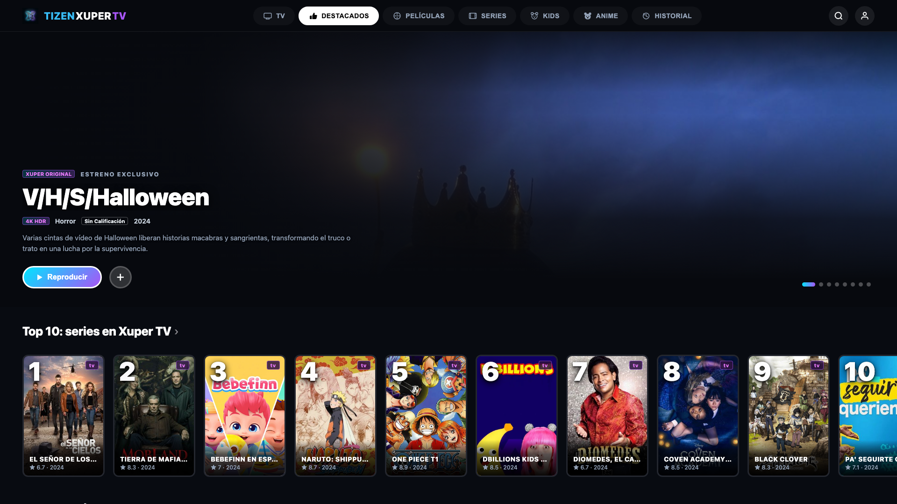
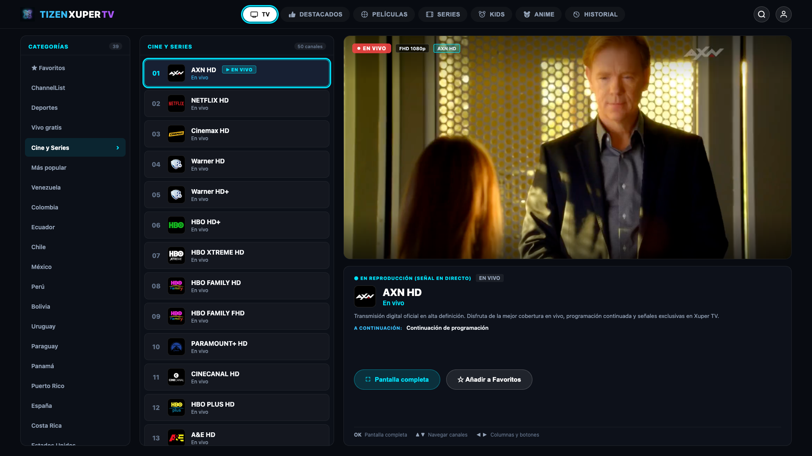
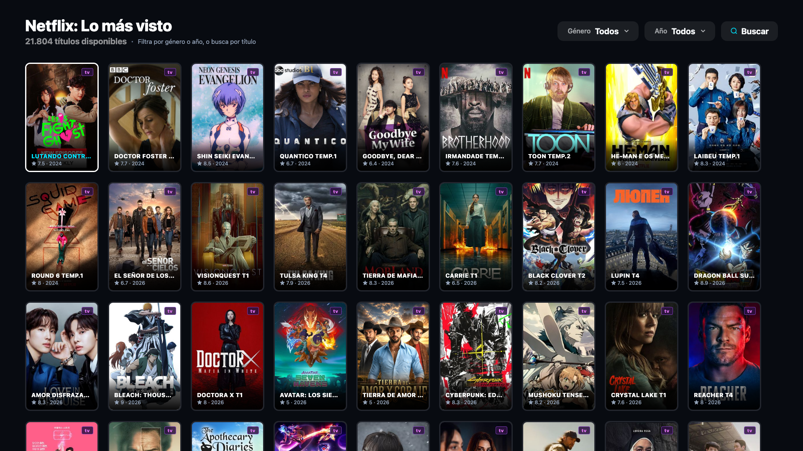
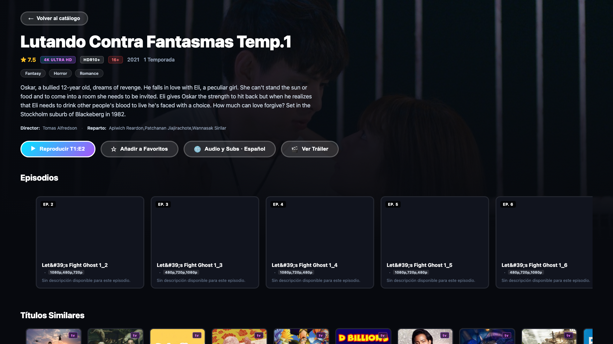
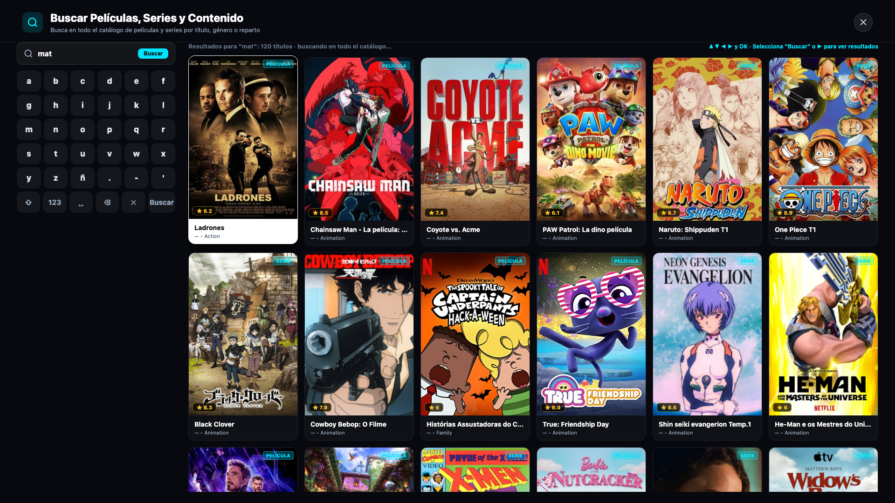
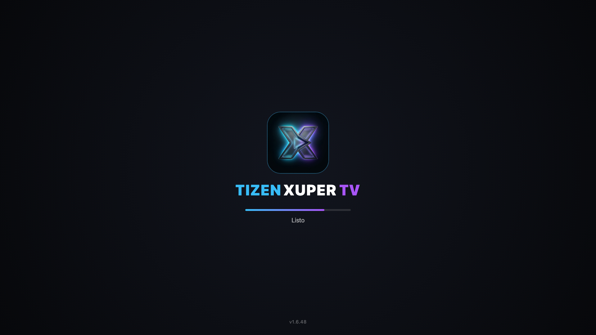
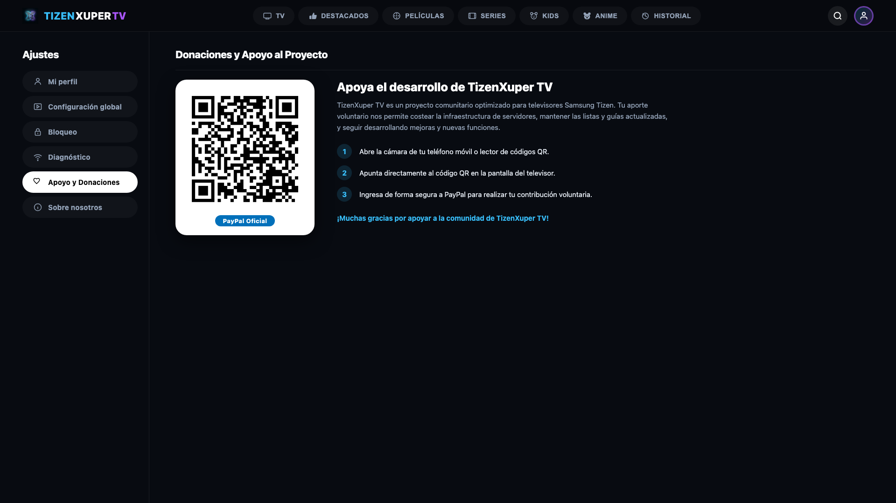
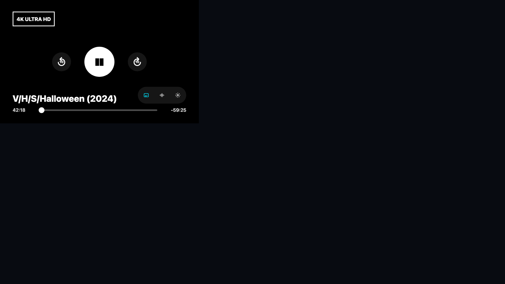

# TizenXuper TV

> **High-performance Live TV and VOD streaming application built specifically for Samsung Smart TVs (Tizen OS 4.0 to 9.0+).**  
> Combines modern React 18 architecture, GPU-accelerated TV spatial navigation, and Samsung AVPlay native hardware decoding for seamless 4K and live stream playback.

---

## 📺 Screenshots

| Featured & Trending | Live TV Guide |
| :---: | :---: |
|  |  |

| Complete VOD Catalog | Title Details & Seasons |
| :---: | :---: |
|  |  |

| On-Screen Remote Keyboard | Splash & Fast Startup |
| :---: | :---: |
|  |  |

| User Profile & Donation | Cinema Playback |
| :---: | :---: |
|  |  |

---

## ✨ Highlights & Features

- **Hardware Accelerated Playback**: Directly utilizes Samsung `webapis.avplay` hardware video pipeline with automatic fallback to HLS.js for maximum codec and audio track compatibility.
- **Full Catalog Exploration**: Seamlessly browse over 21,000+ movies, series, and anime categorized by genres, release year, country, and resolution (4K UHD / 1080p).
- **Interactive Live TV Guide**: 3-column navigation (Categories, Channel List, Live Video Preview & Info) with instant channel switching.
- **TV-Optimized Remote Keyboard**: Full QWERTY on-screen keyboard tailored for 5-way D-Pad remote navigation, instant search filtering, and history.
- **Fast Startup & IndexedDB Cache**: Local offline caching for posters, categories, and channels; parallel TripleDES decryption in a dedicated Web Worker to maintain smooth 60fps UI animations.
- **Sign-in with Telegram**: Required on first launch: the TV shows a QR code that opens the TizenXuper bot in Telegram; one tap links the TV. Only the session is stored on the server (Telegram name, TV model, app version); history and favorites stay on the TV.
- **Problem Reports**: Perfil › Diagnóstico › *Enviar reporte a soporte* sends the TV model, network type, supported formats and the last playback errors (stream hosts only, never links or tokens) to support through the Telegram bot; the answer arrives in Telegram.
- **100% Samsung Remote Friendly**: Fully responsive to Samsung Smart Remote controls (D-Pad, Select, Return/Back, Play/Pause, Channel Up/Down, Volume, and Color buttons).

---

## 📥 Installation

### Method 1: TizenXuper TV for Android (Recommended ⭐)

The official, easiest, and fastest way to install TizenXuper TV on your Samsung TV directly from your Android phone:

1. **Enable Developer Mode on your Samsung TV**:
   - Go to **Apps** in Smart Hub.
   - Enter `1 2 3 4 5` on your remote.
   - Switch Developer Mode to **ON** and set your Android phone's local IP address as the **Host PC IP**.
   - Restart the TV (hold the Power button on the remote for 3 seconds).
2. Download and install the **TizenXuper TV Android Installer App**:  
   👉 **[Download Installer APK](https://tizenxuper-tv.pages.dev/apk)** (Full Guide: [tizenxuper-tv.pages.dev](https://tizenxuper-tv.pages.dev))
3. Open **TizenXuper TV para Android** on your phone (connected to the same Wi-Fi as the TV). The app will automatically find your Samsung TV.
4. Sign in with your Samsung Account (only required on the very first installation) so the app can generate the TV-specific certificate automatically.
5. Tap **Instalar TizenXuper TV**. The app will be signed and installed in seconds, and automatically opens on your TV!  
   *(The Android app also doubles as a convenient virtual remote control for your TV).*

---

### Method 2: Via Apps2Samsung (For PC & Apps2Samsung Users)

If you are using a computer (Windows, macOS, Linux) or prefer using **[Apps2Samsung](https://github.com/Apps2Samsung/Apps2Samsung)**:

#### Option A: Add the Official Signed Repository (Automatic Updates)
Add our signed repository source to install and update TizenXuper TV directly inside Apps2Samsung (v3.2.0 or higher):
- **Repository URL**: `https://tizenxupertv.github.io/TizenXuperTV/repository.json.signed`
- **Key Fingerprint**: `3d259222b72643030121699cbfe73165aad7d6cc6c2f8c68a2d6468b323480bc`

1. Open Apps2Samsung on your PC or mobile device.
2. Go to **Settings > Installing > Your sources** (or *Fuentes / Repositorios*).
3. Click **Add a source** and paste the Repository URL above.
4. Verify that the key fingerprint matches and approve it.
5. TizenXuper TV will now appear in your catalog list, always up-to-date and ready to install in one click!  
   *(If you use [TV-Store](https://github.com/Apps2Samsung/TV-Store) on your TV, choose **Toolbox > Send sources to TV** in Apps2Samsung to add it there as well).*

#### Option B: Manual .wgt Package Installation
1. Ensure your TV has Developer Mode enabled with your computer's IP as Host PC IP.
2. Download `TizenXuperTV.wgt` from the [Latest Release](https://github.com/tizenxupertv/TizenXuperTV/releases/latest).
3. In Apps2Samsung, click **Install a file…** (PC) or **Your own package › WGT / TPK** (Android), select the file, and click **Install on** your TV.

From 1.10.0 on, the app updates itself. To move to 1.10.0 from an older version, install the new `.wgt` over the installed one (keep **Install over installed version** on in Apps2Samsung's settings to keep your data).

---

## 🎮 Remote Control Mappings

| Button | Action |
|---|---|
| **D-Pad (Arrows)** | Move focus between tiles, buttons, tabs, and keyboard keys |
| **Enter / Select** | Open highlighted title, play channel, press key |
| **Return / Back** | Close modal, close keyboard, step back in menu hierarchy, exit player |
| **Play / Pause** | Toggle playback in cinema player and live TV |
| **Ch Up / Down** | Fast previous/next channel switching in live TV |
| **Exit** | Return to Samsung Smart Hub / Home screen |

---

## 📦 Releases & Auto-Updates

- **Automatic Updates**: From version 1.10.0 onwards, TizenXuper TV automatically checks for and applies verified background updates on your Samsung TV.
- **Manual Installation**: You can download official `.wgt` packages directly from the [Releases page](https://github.com/tizenxupertv/TizenXuperTV/releases).

---

## 🌐 Community & Beta Testing

TizenXuper TV has a three-tier Telegram community:

| Space | Purpose | Link |
|---|---|---|
| **Canal TizenXuper TV** | Official announcements and release posts | [@TizenXuperTV](https://t.me/TizenXuperTV) |
| **Comunidad / Soporte** | General user support and discussion | [@TizenXuperTVSoporte](https://t.me/TizenXuperTVSoporte) |
| **TizenXuper TV Beta** | Segmented beta testing by TV generation | [Invite link](https://t.me/+CTPQE5XuzFA3MDkx) |

### Beta Group Topics

The Beta group is a Telegram forum with dedicated topics per TV generation:

| Topic | Thread ID | Purpose |
|---|---|---|
| **Legacy** (Tizen 4.0) | 7 | Tests on Tizen 4.0 TVs (2018) |
| **Mid-Gen** (Tizen 5.0–5.5) | 8 | Tests on Tizen 5.0–5.5 TVs (2019–2020) |
| **Moderno** (Tizen 6.0+) | 9 | Tests on Tizen 6.0+ TVs (2021 and later) |
| **Instalacion y Certificados** | 16 | Installation, signing, and certificate help |
| **Reporte de Fallos y Canales** | 17 | Bug reports and broken channel reports |
| **Sugerencias e Ideas** | 18 | Feature requests and improvement suggestions |
| **Anuncios y Pruebas** | 19 | Beta announcements and test builds |

### Bot Commands for Beta Members

The [@TizenXuperBot](https://t.me/TizenXuperBot) provides direct deep-links into the correct topic:

- `/mitv [model]` — classifies your TV by generation and links the matching topic  
  Example: `mitv UE55RU7400` → Mid-Gen topic
- `/beta` — full beta group info and topic directory
- `/tizen` — Tizen generation reference table (4.0 to 9.0+)

Join the beta group: `https://t.me/+CTPQE5XuzFA3MDkx`

---

## 📄 License

This project is licensed under the [MIT License](LICENSE).
